# agent-workflow (v3.0 Universal — Completo)

Plugin orquestrador de desenvolvimento multi-agente padronizado para governança, rastreabilidade e qualidade rigorosa no ciclo de vida de desenvolvimento de software. Compatível nativamente com **Claude Code**, **GitHub Copilot** e **Cursor**, adaptando-se dinamicamente a **Jira**, **Azure DevOps**, **TFS** ou **tarefas por descrição livre** (sem atividade cadastrada no board).

---

## Como Funciona

O sistema opera via uma **Sessão Principal como Orquestrador**, onde o assistente principal de IA assume o papel definido em `playbook-orquestrador.md`. O Orquestrador não executa alterações diretas de código quando há agentes especializados designados; em vez disso, ele:

1. **Rastreia o Progresso:** Mantém o estado completo das etapas ativo durante toda a execução (`TodoWrite` no Claude Code / checklist interno no Cursor e Copilot).
2. **Interage via Janelas Modais:** Utiliza obrigatoriamente as ferramentas interativas nativas (`AskUserQuestion` no Claude Code, `AskQuestion` no Cursor e `askQuestions` no Copilot) para coletar respostas em blocos na configuração e solicitar confirmações críticas (escopo, dúvidas de negócio, estouro de tentativas de build e autorização de `git push`).
3. **Entrada Flexível (Com Card ou Por Descrição Livre):** Aceita tanto uma **chave/link de tarefa** (`PROJ-123`, `AB#12345`, URL) quanto uma **descrição textual direta** (para adiantar um desenvolvimento ou atuar sem atividade no board, gerando um identificador local `LOCAL-<slug>` e pulando apenas a sincronização externa com o board).
4. **Acesso Global às Ferramentas de Terminal (`PowerShell` / `Bash`):** O Orquestrador e os agentes operacionais (`Executor`, `Validador`, `QA`, `Especialista em Commits`) possuem acesso explícito às ferramentas de terminal da máquina para compilar, rodar testes, validar linters e operar o Git, enquanto agentes de especificação/auditoria têm ferramentas restritas às suas funções.
5. **Memória e Aprendizado Contínuo da Squad (`.fluxo/aprendizados.md`):** Todos os agentes **leem** `.fluxo/aprendizados.md` antes de iniciar sua etapa e **registram** novos aprendizados ao resolver problemas do repositório, evoluindo o conhecimento coletivo da squad.
6. **Observabilidade em Tempo Real (`.fluxo/status-atual.md` + `/status-fluxo`):** O Orquestrador atualiza o painel ao vivo `.fluxo/status-atual.md` (que você pode deixar aberto com *Markdown Preview* na IDE), salva todos os entregáveis em `.fluxo/execucoes/<ID-TAREFA>/`, emite banners visuais no chat a cada transição de agente (`▶️ [SQUAD | Etapa X] Acionando...` / `✅ [SQUAD | Etapa X] Concluído...`) e disponibiliza o comando `/status-fluxo` (`/fluxo:status-fluxo` no Claude Code).
7. **Descobre o Ambiente Dinamicamente:** Quando um MCP de rastreador está ativo, inspeciona o projeto/board para mapear colunas, estados válidos, vocabulário (`Story`/`User Story`/`Product Backlog Item`/`Issue` e `Sub-task`/`Task`/`Subtarefa`) e padrão de subtarefas, ajustando o fluxo sem bloqueios desnecessários.
8. **Delega para Subagentes (`Task` / `runSubagent`):** Encadeia automaticamente os 9 papéis especializados ativos (usando o prefixo `fluxo:<papel>` no Claude Code), gerenciando a passagem de contexto e impondo as travas de segurança e qualidade do projeto.

---

## Fluxo de Execução Orquestrado

```mermaid
flowchart TD
    Start(["/orquestrador-desenvolvimento <CARD ou DESCRIÇÃO>"]) --> CheckCfg{".fluxo/config-modelo.md existe?"}
    CheckCfg -- Não --> Cfg["/configurar-fluxo (Blocos A-I + MCPs) ou Padrões do Plugin"]
    CheckCfg -- Sim --> Step0["0. Confirmação Inicial, Leitura de Aprendizados & Triagem (Modal)"]
    Cfg --> Step0
    Step0 --> Step1["1. PO (fluxo:po): Definição & Critérios (historia.md)"]
    Step1 --> Step2["2. Planejador (fluxo:planejador): Plano Técnico (plano.md)"]
    Step2 --> DecArch{"Precisa de Arquiteto?"}
    DecArch -- Sim --> Step2a["2a. Arquiteto (fluxo:arquiteto): Decisão/ADRs (arquitetura.md)"]
    DecArch -- Não --> Step2c["2c. Criar Branch Feature"]
    Step2a --> Step2c
    Step2c --> DecCard{"Tem Card no Rastreador?"}
    DecCard -- Sim --> Step3["3. Sincronizador (fluxo:sincronizador-tarefas): Atualiza Board & Subtarefas"]
    DecCard -- "Não (Descrição Livre)" --> Step4["4. Executor (fluxo:executor): Implementação do Código & Testes"]
    Step3 --> Step4
    Step4 --> Step5["5. Validador (fluxo:validador): Checklist 10 Itens & Testes Locais"]
    Step5 --> DecVal{"Validação Passou?"}
    DecVal -- "Não (Loops <= limite)" --> Step4
    DecVal -- Sim --> DecTA{"Testes Aceite ativo?"}
    DecTA -- Sim --> Step6b["6b. Especialista TA (fluxo:especialista-testes-aceite): BDD/Manual & Quality Gate"]
    DecTA -- Não --> DecQG
    Step6b --> DecQG{"Quality Gate / Sonar ativo?"}
    DecQG -- Sim --> Step6c["6c. Quality Gate / Pipeline Checks"]
    DecQG -- Não --> DecQA
    Step6c --> DecQA{"QA ativo e requerido?"}
    DecQA -- Sim --> Step6d["6d. QA (fluxo:qa): Validação Funcional (qa.md)"]
    DecQA -- Não --> Step7
    Step6d --> Step7["7. Especialista Commits (fluxo:especialista-commits): Commits Atômicos"]
    Step7 --> Step8["8. Confirmação Push (Modal) & Abertura de PR"]
    Step8 --> StepSync["Sincronizador: Atualiza Tracker (se houver card) & Aprendizados"]
    StepSync --> End(["Fim do Fluxo"])
```



---

## Etapas do Fluxo

| Etapa | Sigla | Papel / Responsável | Descrição / Entregável Principal |
| :--- | :---: | :--- | :--- |
| **0. Confirmação** | OR | Orquestrador | Alinha escopo via modal, confirma chave da tarefa, verifica precondições e descobre board via MCP (se ativo). |
| **1. Definição** | PO | Product Owner | Refina a história/tarefa no padrão INVEST, gera `historia.md` com critérios BDD e define `tarefa_sem_qa`. |
| **2. Plano** | PL | Planejador | Cria `plano.md`, mapeia arquivos, verifica contratos OpenAPI/banco (se ativos), ADRs e define branch. |
| **2a. Arquitetura** | AR | Arquiteto | *Condicional*. Avalia mudanças estruturais (`[REVISAO_ARQUITETURA]`) e registra parecer e ADRs em `arquitetura.md`. |
| **2c. Branch** | BR | Git Bot / Orquestrador | Garante checkout da branch padronizada (`feature/PROJ-123-descricao`). |
| **3. Rastreador** | SY | Sincronizador Tarefas | Move o card para o estado inicial mapeado, cria subtarefas padrão e registra a branch. |
| **4. Execução** | EX | Executor | Implementa código de produção e testes unitários seguindo o plano e padrões do projeto. |
| **5. Validação** | VA | Validador | Executa o checklist dinâmico de 10 itens (Build, Testes, Cobertura, Lint, Segurança, Contratos OpenAPI se ativos). |
| **6b. Testes Aceite** | TA | Esp. Testes Aceite | *Condicional*. Gera cenários BDD/Gherkin e casos manuais para Xray/Azure Test Plans + verificação interna de Quality Gate. |
| **6c. Quality Gate** | QG | Orquestrador / CI | *Condicional*. Executa medição SonarQube/Pipeline e verifica thresholds (ignorado se `fluxo_direto_para_qa: true`). |
| **6d. QA** | QA | Analista de QA | *Condicional*. Executa validação funcional/regressiva em homologação (`hml`/`staging`) quando `qa.ativo` e `tarefa_sem_qa: false`. |
| **7. Commit** | CM | Esp. Commits | Organiza alterações em commits atômicos padronizados (*Conventional Commits*) e prepara PR. |
| **8. Push & PR** | PR | Esp. Commits | Solicita confirmação explícita antes do `git push`, abre a Pull Request e sincroniza o card. |

---

## Travas Invioláveis do Fluxo

1. **Contrato de API:** Quando `gateway_api.verificar_contratos: true`, mudanças em endpoints ou payloads requerem validação prévia no OpenAPI/Gateway (RFC 7807 para erros, compatibilidade retroativa).
2. **Cobertura de Testes:** Código novo sem testes unitários atingindo a cobertura mínima configurada é bloqueado pelo `Validador`.
3. **Git Hygiene:** Commits diretos na branch principal (`main`/`master`) são proibidos; `git push` nunca ocorre sem autorização explícita.
4. **Regra de Negócio:** Alterações em regras existentes exigem atualização simultânea das suítes de regressão.
5. **Escopo Fechado na Demanda Ativa:** Nenhuma alteração de código é executada fora dos critérios de aceite da história/demanda ativa (iniciada por card no rastreador ou por descrição textual direta).
6. **Tolerância a Falhas Controlada:** Respeita o limite configurado (`tolerancia_falhas.max_tentativas_build_validacao`) antes de escalar ao usuário.

---

## Tabela de Papéis e Modelos Recomendados

| Papel | Responsabilidade Principal | Altera Código? | Modelo Sugerido |
| :--- | :--- | :---: | :--- |
| **PO** | Refinamento de requisitos (INVEST), critérios BDD e definição de `tarefa_sem_qa`. | Não | Padrão / Rápido |
| **Planejador** | Estruturação do plano técnico, impacto em contratos/banco, ADRs e estratégia de testes. | Não | Forte |
| **Arquiteto** | Avaliação de impacto não funcional, design patterns e ADRs em `arquitetura.md`. | Não | Forte |
| **Executor** | Implementação de código-fonte e suítes de testes (respeitando limite de tentativas). | Sim | Forte / Padrão |
| **Validador** | Auditoria rigorosa do checklist de 10 pontos antes da liberação. | Não | Padrão |
| **Esp. Testes Aceite** | Criação e vinculação de cenários Gherkin/Manuais no Xray/Azure Test Plans + verificação interna de Quality Gate. | Não | Padrão |
| **QA** | Validação ponta a ponta (E2E), borda, regressão e segurança básica em homologação (`qa.md`). | Não | Padrão |
| **Sincronizador** | Atualização de status, subtarefas, links de branch/PR e comentários auditáveis no rastreador. | Não | Rápido |
| **Esp. Commits** | Criação de commits atômicos, push autorizado e abertura de Pull Requests. | Não | Rápido |

---

## Configuração Local Pessoal (`~/.fluxo-desenvolvimento/`)

Cada desenvolvedor pode ter suas preferências locais sem impactar o repositório central através do diretório pessoal:
- `~/.fluxo-desenvolvimento/config.md`: Parâmetros de override de ferramentas, modelos e pipelines.
- `~/.fluxo-desenvolvimento/regras.md`: Diretrizes locais de estilo de trabalho.
- `~/.fluxo-desenvolvimento/conhecimento/<papel>.md`: Contexto customizado para agilizar a atuação dos papéis.

---

## Instalação e Como Usar

### 1. Compilar Adaptadores (após editar `fluxo/core/`)
```bash
node fluxo/scripts/gerar-adaptadores-fluxo.mjs
```

### 2. Instalar no Claude Code (Plugin Autocontido via Marketplace Local)
Dentro do Claude Code, adicione a pasta deste repositório como marketplace e instale o plugin `fluxo`:
```text
/plugin marketplace add C:\caminho\para\agent-workflow
/plugin install fluxo@agent-workflow
```
Para usar em qualquer repositório:
- Configurar o repositório atual (gera `.fluxo/config-modelo.md`):
  `/fluxo:configurar-fluxo`
- Iniciar desenvolvimento com card ou por descrição livre:
  `/fluxo:orquestrador-desenvolvimento PROJ-123`
  `/fluxo:orquestrador-desenvolvimento Criar endpoint de exportação CSV no módulo de relatórios`
- Acompanhar a execução dos agentes em tempo real:
  `/fluxo:status-fluxo` (ou abra `.fluxo/status-atual.md` no editor)

### 3. Instalar no GitHub Copilot e Cursor (Global ou Por Repositório)
```bash
# Instalação Global (Copilot no VS Code + Comandos e Subagentes Globais do Cursor + Núcleo em ~/.fluxo-desenvolvimento)
node fluxo/scripts/instalar-fluxo-no-repositorio.mjs --global

# Ou Instalação Isolada por Repositório (adiciona automaticamente ao .git/info/exclude)
node fluxo/scripts/instalar-fluxo-no-repositorio.mjs --alvo /caminho/do/projeto --ferramentas copilot,cursor --local
```
### 4. Como Atualizar uma Instalação Existente (Sem Perder sua Configuração)

Sempre que houver mudanças neste repositório (`fluxo/core/`):

1. **Recompile os adaptadores:**
   ```bash
   node fluxo/scripts/gerar-adaptadores-fluxo.mjs
   ```
2. **Para atualizar o GitHub Copilot, o Cursor e o Núcleo Global (`~/.fluxo-desenvolvimento`):**
   ```bash
   # Atualiza agentes, prompts e comandos globais preservando config-modelo.md e aprendizados.md
   node fluxo/scripts/instalar-fluxo-no-repositorio.mjs --global --atualizar

   # Se você também instalou localmente em um repositório específico:
   node fluxo/scripts/instalar-fluxo-no-repositorio.mjs --alvo /caminho/do/projeto --local --atualizar
   ```
   *(O instalador preserva automaticamente seu `.fluxo/config-modelo.md` e `.fluxo/aprendizados.md` já configurados. Caso queira resetar o `config-modelo.md` para o padrão de fábrica, adicione `--forcar-config`).*
3. **Para atualizar o Plugin no Claude Code:**
   Dentro do chat do Claude Code, execute:
   ```text
   /plugin marketplace update agent-workflow
   /plugin update fluxo@agent-workflow
   ```
   *(Dica: se a versão `3.0.0` em `fluxo/versao.json` não tiver mudado e o Claude Code mantiver o cache da versão, basta rodar `/plugin uninstall fluxo@agent-workflow` e em seguida `/plugin install fluxo@agent-workflow`, e recarregar a janela do VS Code com `Developer: Reload Window`).*

