# agent-workflow (v3.0 Universal — Completo)

Plugin orquestrador de desenvolvimento multi-agente padronizado para governança, rastreabilidade e qualidade rigorosa no ciclo de vida de desenvolvimento de software. Compatível nativamente com **Claude Code**, **GitHub Copilot** e **Cursor**, adaptando-se dinamicamente a **Jira**, **Azure DevOps** ou **TFS**.

---

## Visão Geral e Capacidades da Squad Agentica

Este projeto implementa um **plugin orquestrador de desenvolvimento multi-agente**, focado na criação de uma **squad agentica** autônoma. O objetivo é automatizar e otimizar o ciclo de vida de desenvolvimento de software, desde o refinamento de requisitos até o deploy, com máxima autonomia e rastreabilidade.

O coração deste sistema é o seu fluxo de trabalho detalhado, que orquestra agentes especializados para cada etapa, gerenciando o progresso, interações e decisões de forma inteligente.

## Como Funciona

O sistema opera via uma **Sessão Principal como Orquestrador**, onde o assistente principal de IA assume o papel definido em `playbook-orquestrador.md`. O Orquestrador não executa alterações diretas de código quando há agentes especializados designados; em vez disso, ele:

1. **Rastreia o Progresso:** Mantém o estado completo das etapas ativo durante toda a execução (`TodoWrite` no Claude Code / checklist interno no Cursor e Copilot).
2. **Interage via Janelas Modais:** Utiliza obrigatoriamente as ferramentas interativas nativas (`AskUserQuestion` no Claude Code, `AskQuestion` no Cursor e `askQuestions` no Copilot) para coletar respostas em blocos na configuração e solicitar confirmações críticas (escopo, dúvidas de negócio, estouro de tentativas de build e autorização de `git push`).
3. **Descobre o Ambiente Dinamicamente:** Quando um MCP de rastreador está ativo, inspeciona o projeto/board para mapear colunas, estados válidos, vocabulário (`Story`/`User Story`/`Product Backlog Item`/`Issue` e `Sub-task`/`Task`/`Subtarefa`) e padrão de subtarefas, ajustando o fluxo sem bloqueios desnecessários.
4. **Delega para Subagentes (`Task`):** Encadeia automaticamente os 9 papéis especializados ativos, gerenciando a passagem de contexto e impondo as travas de segurança e qualidade do projeto.

---

## Fluxo de Execução Orquestrado

```mermaid
flowchart TD
    Start(["/orquestrador-desenvolvimento PROJ-123"]) --> CheckCfg{"config-modelo.md existe?"}
    CheckCfg -- Não --> Cfg["/configurar-fluxo (Blocos A-I + MCPs)"]
    CheckCfg -- Sim --> Step0["0. Confirmação Inicial & Descoberta Board (Modal)"]
    Cfg --> Step0
    Step0 --> Step1["1. PO: Definição & Critérios"]
    Step1 --> Step2["2. Planejador: Plano Técnico"]
    Step2 --> DecArch{"Precisa de Arquiteto?"}
    DecArch -- Sim --> Step2a["2a. Arquiteto: Decisão/Aprovação (ADRs)"]
    DecArch -- Não --> Step2c["2c. Criar Branch Feature"]
    Step2a --> Step2c
    Step2c --> Step3["3. Sincronizador: Atualiza Board & Subtarefas"]
    Step3 --> Step4["4. Executor: Implementação do Código"]
    Step4 --> Step5["5. Validador: Checklist 10 Itens & Testes Locais"]
    Step5 --> DecVal{"Validação Passou?"}
    DecVal -- "Não (Loops <= limite)" --> Step4
    DecVal -- Sim --> DecTA{"Testes Aceite ativo?"}
    DecTA -- Sim --> Step6b["6b. Especialista TA: Testes de Aceite & Quality Gate"]
    DecTA -- Não --> DecQG
    Step6b --> DecQG{"Quality Gate / Sonar ativo?"}
    DecQG -- Sim --> Step6c["6c. Quality Gate / Pipeline Checks"]
    DecQG -- Não --> DecQA
    Step6c --> DecQA{"QA ativo e requerido?"}
    DecQA -- Sim --> Step6d["6d. QA: Validação Funcional"]
    DecQA -- Não --> Step7
    Step6d --> Step7["7. Especialista Commits: Commits Atômicos"]
    Step7 --> Step8["8. Confirmação Push (Modal) & Abertura de PR"]
    Step8 --> StepSync["Sincronizador: Atualiza Tracker (PR Vinculado)"]
    StepSync --> End(["Fim do Fluxo"])
```



## Compatibilidade Multiplataforma de IA

A arquitetura do workflow_agente é projetada para ser compatível e adaptável a múltiplas plataformas de assistentes de IA, incluindo **Claude Code**, **GitHub Copilot** e **Cursor**. Um script de orquestração de exemplo, [orquestrador-squad-agentica.mjs](scripts/orquestrador-squad-agentica.mjs), ilustra a adaptabilidade, mostrando como a delegação de tarefas e a interação entre agentes podem ser implementadas em cada ambiente, garantindo um fluxo de trabalho consistente e eficiente.

---

## Etapas do Fluxo

| Etapa | Sigla | Papel / Responsável | Descrição / Entregável Principal |
| :--- | :---: | :--- | :--- |
| **0. Confirmação** | OR | Orquestrador | Alinha escopo via modal, confirma chave da tarefa, verifica precondições e descobre board via MCP (se ativo). |
| **1. Definição** | PO | Product Owner | Refina a história/tarefa no padrão INVEST, gera `historia.md` com critérios BDD e define `tarefa_sem_qa`. |
| **2. Plano** | PL | Planejador | Cria `plano.md`, mapeia arquivos, verifica contratos OpenAPI/banco (se ativos), ADRs e define branch. |
| **2a. Arquitetura** | AR | Arquiteto | *Condicional*. Avalia mudanças estruturais (`[REVISAO_ARQUITETURA]`) e registra parecer e ADRs em `arquitetura.md`. |
| **2c. Branch** | BR | Git Bot / Orquestrador | Garante checkout da branch padronizada (`feature/PROJ-123-descricao`). |
| **3. Rastreador** | SY | Sincronizador Tarefas | Move o card para o estado inicial mapeado, cria subtarefas padrão e registra a branch. |
| **4. Execução** | EX | Executor | Implementa código de produção e testes unitários seguindo o plano e padrões do projeto. |
| **5. Validação** | VA | Validador | Executa o checklist dinâmico de 10 itens (Build, Testes, Cobertura, Lint, Segurança, Contratos OpenAPI se ativos). |
| **6b. Testes Aceite** | TA | Esp. Testes Aceite | *Condicional*. Gera cenários BDD/Gherkin e casos manuais para Xray/Azure Test Plans + `checar-quality-gate`. |
| **6c. Quality Gate** | QG | Orquestrador / CI | *Condicional*. Executa medição SonarQube/Pipeline e verifica thresholds (ignorado se `fluxo_direto_para_qa: true`). |
| **6d. QA** | QA | Analista de QA | *Condicional*. Executa validação funcional/regressiva em homologação (`hml`/`staging`) quando `qa.ativo` e `tarefa_sem_qa: false`. |
| **7. Commit** | CM | Esp. Commits | Organiza alterações em commits atômicos padronizados (*Conventional Commits*) e prepara PR. |
| **8. Push & PR** | PR | Esp. Commits | Solicita confirmação explícita antes do `git push`, abre a Pull Request e sincroniza o card. |

---

## Travas Invioláveis do Fluxo

1. **Contrato de API:** Quando `gateway_api.verificar_contratos: true`, mudanças em endpoints ou payloads requerem validação prévia no OpenAPI/Gateway (RFC 7807 para erros, compatibilidade retroativa).
2. **Cobertura de Testes:** Código novo sem testes unitários atingindo a cobertura mínima configurada é bloqueado pelo `Validador`.
3. **Git Hygiene:** Commits diretos na branch principal (`main`/`master`) são proibidos; `git push` nunca ocorre sem autorização explícita.
4. **Regra de Negócio:** Alterações em regras existentes exigem atualização simultânea das suítes de regressão.
5. **Sem Trabalho Fora de História:** Nenhuma alteração de código é executada sem estar vinculada a um card válido no rastreador.
6. **Tolerância a Falhas Controlada:** Respeita o limite configurado (`tolerancia_falhas.max_tentativas_build_validacao`) antes de escalar ao usuário.

---

## Tabela de Papéis e Modelos Recomendados

| Papel | Responsabilidade Principal | Altera Código? | Modelo Sugerido |
| :--- | :--- | :---: | :--- |
| **PO** | Refinamento de requisitos (INVEST), critérios BDD e definição de `tarefa_sem_qa`. | Não | Padrão / Rápido |
| **Planejador** | Estruturação do plano técnico, impacto em contratos/banco, ADRs e estratégia de testes. | Não | Forte |
| **Arquiteto** | Avaliação de impacto não funcional, design patterns e ADRs em `arquitetura.md`. | Não | Forte |
| **Executor** | Implementação de código-fonte e suítes de testes (respeitando limite de tentativas). | Sim | Forte / Padrão |
| **Validador** | Auditoria rigorosa do checklist de 10 pontos antes da liberação. | Não | Padrão |
| **Esp. Testes Aceite** | Criação e vinculação de cenários Gherkin/Manuais no Xray/Azure Test Plans + `checar-quality-gate`. | Não | Padrão |
| **QA** | Validação ponta a ponta (E2E), borda, regressão e segurança básica em homologação (`qa.md`). | Não | Padrão |
| **Sincronizador** | Atualização de status, subtarefas, links de branch/PR e comentários auditáveis no rastreador. | Não | Rápido |
| **Esp. Commits** | Criação de commits atômicos, push autorizado e abertura de Pull Requests. | Não | Rápido |

---

## Configuração Local Pessoal (`~/.fluxo-desenvolvimento/`)

Cada desenvolvedor pode ter suas preferências locais sem impactar o repositório central através do diretório pessoal:
- `~/.fluxo-desenvolvimento/config.md`: Parâmetros de override de ferramentas, modelos e pipelines.
- `~/.fluxo-desenvolvimento/regras.md`: Diretrizes locais de estilo de trabalho.
- `~/.fluxo-desenvolvimento/conhecimento/<papel>.md`: Contexto customizado para agilizar a atuação dos papéis.

---

## Configuração e Uso

### Flexibilidade na Definição de Tarefas

O `workflow_agente` permite que as tarefas de desenvolvimento sejam iniciadas de diferentes formas:

*   Através de **links ou IDs de sistemas de rastreamento de tarefas** (como Jira, Azure DevOps ou GitHub Issues), quando configurado.
*   Por **descrições textuais diretas** fornecidas pelo usuário, permitindo agilidade para tarefas de desenvolvimento sem vínculo formal a um board.

A preferência e a configuração do provedor de tarefas são gerenciadas no arquivo de modelo: [config-modelo.md](plugins/fluxo/config-modelo.md), na seção `rastreador.provedor`.

### Acesso a Ferramentas do Sistema (PowerShell, Git, etc.)

É fundamental compreender que o **acesso a ferramentas do sistema**, como o PowerShell para a execução de comandos de build, teste, linter, ou ferramentas Git para controle de versão, é uma capacidade nativa e intrínseca do ambiente do assistente de IA (via Copilot SDK e seus equivalentes em outras plataformas). O `workflow_agente` e seus agentes definem **como** e **quando** essas ferramentas devem ser utilizadas dentro do fluxo orquestrado, mas não são responsáveis por conceder ou configurar o acesso a elas.

### Executando o Orquestrador de Exemplo

Para visualizar e testar o fluxo simulado da squad agentica, você pode executar o script de orquestração de exemplo utilizando Node.js no seu terminal PowerShell:

```powershell
# Para simular o fluxo para GitHub Copilot (será o padrão se nenhum argumento for fornecido)
node .\scripts\orquestrador-squad-agentica.mjs copilot

# Para simular o fluxo para Cursor
node .\scripts\orquestrador-squad-agentica.mjs cursor

# Para simular o fluxo para Claude
node .\scripts\orquestrador-squad-agentica.mjs claude
```

### Iniciando uma Tarefa com o Agente Orquestrador

Após a instalação e configuração do plugin em sua plataforma de IA, você pode iniciar um fluxo de desenvolvimento com a squad agentica interagindo diretamente com o Agente Orquestrador em seu ambiente de chat.

#### **1. GitHub Copilot**

1.  **Abra o Copilot Chat** na sua IDE.
2.  **Invoque o Agente Orquestrador** usando o prompt de invocação e fornecendo a tarefa:
    *   **Sintaxe:** `@orquestrador {{DESCRIÇÃO_DA_TAREFA_OU_ID}}`
    *   **Exemplos:**
        *   `@orquestrador Implementar funcionalidade de login com autenticação OAuth2.`
        *   `@orquestrador PROJ-456` (se o rastreador de tarefas estiver configurado).
3.  **Interaja no Chat:** O Agente Orquestrador o manterá atualizado sobre o progresso e fará perguntas para aprovações ou decisões críticas (via `askQuestions`).

#### **2. Cursor**

1.  **Abra o Cursor Chat** ou a barra de comandos (`Ctrl+Shift+P`).
2.  **Invoque o Comando Orquestrador** que inicia o fluxo:
    *   **Sintaxe:** `/orquestrador-desenvolvimento {{DESCRIÇÃO_DA_TAREFA_OU_ID}}`
    *   **Exemplos:**
        *   `/orquestrador-desenvolvimento Criar módulo de autenticação de usuários.`
        *   `/orquestrador-desenvolvimento US-789`
3.  **Interaja no Chat:** O Cursor executará o comando, e o Orquestrador o guiará pelo fluxo, solicitando feedback via `AskQuestion` quando necessário.

#### **3. Claude (Conceitual - Depende da Integração de Plugins)**

1.  **Abra o Claude Chat** (ou o ambiente de interação com agentes/skills).
2.  **Invoque o Agente Orquestrador** e forneça a tarefa:
    *   **Sintaxe (conceitual):** `@Orquestrador {{DESCRIÇÃO_DA_TAREFA}}`
    *   **Exemplos:**
        *   `@Orquestrador Desenvolver funcionalidade de carrinho de compras.`
        *   `@Orquestrador Adicionar suporte a múltiplos idiomas na aplicação.`
3.  **Interaja no Chat:** O Orquestrador o manterá informado e solicitará sua intervenção em pontos de decisão.

---

## Instalação

```bash
# 1. Recompilar os adaptadores a partir de fluxo/core/
node fluxo/scripts/gerar-adaptadores-fluxo.mjs

# 2. Instalação Global (Cursor + Copilot + Núcleo)
node fluxo/scripts/instalar-fluxo-no-repositorio.mjs --global

# 3. Instalação Isolada por Repositório (adiciona ao .git/info/exclude)
node fluxo/scripts/instalar-fluxo-no-repositorio.mjs --alvo /caminho/do/projeto --ferramentas copilot,cursor,claude --local

# 4. Claude Code (escopo de usuário)
claude plugin add --scope user ./plugins/fluxo
```
