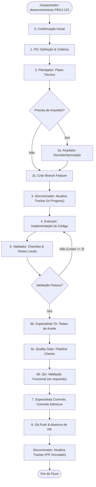

# agent-workflow

Plugin orquestrador de desenvolvimento multi-agente padronizado para governança, rastreabilidade e qualidade rigorosa no ciclo de vida de desenvolvimento de software. Compatível com **Claude Code**, **GitHub Copilot** e **Cursor**.

## Como Funciona

O sistema opera via uma **Sessão Principal como Orquestrador**, onde o assistente principal de IA assume o papel definido em `playbook-orquestrador.md`. O Orquestrador não executa alterações diretas de código se houver agentes especializados designados; ele interpreta a intenção, invoca sequencialmente os papéis especializados, gerencia a passagem de contexto e impõe as travas de segurança e qualidade.

## Fluxo de Execução Orquestrado



## Etapas do Fluxo

| Etapa | Sigla | Papel / Responsável | Descrição / Entregável Principal |
|---|---|---|---|
| **0. Confirmação** | OR | Orquestrador | Alinha escopo, confirma a chave da tarefa e verifica precondições. |
| **1. Definição** | PO | Product Owner | Refina a história/tarefa, valida critérios de aceite e define `tarefa_sem_qa`. |
| **2. Plano** | PL | Planejador | Cria plano técnico, mapeia arquivos, verifica contratos e define branch. |
| **2a. Arquitetura** | AR | Arquiteto | *Opcional*. Avalia mudanças estruturais, padrões e segurança em `arquitetura.md`. |
| **2c. Branch** | BR | Git Bot / Orquestrador | Garante checkout da branch padronizada (`feature/PROJ-123-descricao`). |
| **3. Rastreador** | SY | Sincronizador Tarefas | Move a tarefa para "In Progress" e registra a branch no Jira/Azure. |
| **4. Execução** | EX | Executor | Escreve código e testes unitários seguindo o plano e as diretrizes do projeto. |
| **5. Validação** | VA | Validador | Executa o checklist de 10 pontos (Build, Testes, Cobertura, Lint, Contratos). |
| **6b. Testes Aceite** | TA | Esp. Testes Aceite | Gera/associa pacotes BDD/Gherkin no Xray ou Azure Test Plans. |
| **6c. Quality Gate** | QG | Orquestrador / CI | Executa a medição Sonar/Pipeline e verifica se o gate foi atingido. |
| **6d. QA** | QA | Analista de QA | Executa testes funcionais/regressivos quando `tarefa_sem_qa` for falso. |
| **7. Commit** | CM | Esp. Commits | Cria commits atômicos padronizados segundo o Conventional Commits. |
| **8. Push & PR** | PR | Esp. Commits | Realiza o push remoto da branch e abre a Pull Request vinculada. |

## Travas Invioláveis do Fluxo

1. **Contrato de API:** Mudanças em endpoints ou payload requerem validação no Gateway/OpenAPI prévia.
2. **Cobertura de Testes:** Não é permitido código novo sem cobertura de testes unitários mínima definida no projeto.
3. **Git Hygiene:** Commits diretos na branch principal (`main`/`master`) são estritamente proibidos.
4. **Regra de Negócio:** Alterações em regras existentes exigem atualização simultânea das suítes de teste de regressão.
5. **Sem Trabalho Fora de História:** Toda alteração deve estar vinculada a um card válido.

## Tabela de Papéis e Modelos Recomendados

| Papel | Responsabilidade Principal | Altera Código? | Modelo Sugerido |
| :--- | :--- | :---: | :--- |
| **PO** | Refinamento de requisitos e critérios de aceite. | Não | Padrão / Rápido |
| **Planejador** | Estruturação do plano de implementação e dependências. | Não | Forte |
| **Arquiteto** | Avaliação de impacto arquitetural e decisões estruturais. | Não | Forte |
| **Executor** | Implementação de código-fonte e suítes de testes unitários. | Sim | Forte / Padrão |
| **Validador** | Verificação rigorosa do checklist de qualidade e build. | Não | Padrão |
| **Esp. Testes Aceite** | Criação e mapeamento de cenários BDD/Gherkin/Xray. | Não | Padrão |
| **QA** | Validação funcional em ambiente integrado. | Não | Padrão |
| **Sincronizador** | Atualização de status e comentários no Jira/Azure DevOps. | Não | Rápido |
| **Esp. Commits** | Organização de commits atômicos e criação de Pull Requests. | Não | Rápido |

## Configuração Local Pessoal (`~/.fluxo-desenvolvimento/`)

- `~/.fluxo-desenvolvimento/config.md`: Parâmetros de override de ferramentas e pipelines.
- `~/.fluxo-desenvolvimento/regras.md`: Diretrizes locais de estilo de trabalho.
- `~/.fluxo-desenvolvimento/conhecimento/<papel>.md`: Contexto customizado por papel.

## Instalação Rápida

### 1. Gerar Adaptadores (caso edite `fluxo/core/`)
```bash
node fluxo/scripts/gerar-adaptadores-fluxo.mjs
```

### 2. Instalar em um Repositório Alvo
```bash
node fluxo/scripts/instalar-fluxo-no-repositorio.mjs --alvo /caminho/do/projeto --ferramentas copilot,cursor,claude --local
```

### 3. Claude Code Plugin
```bash
claude plugin add ./plugins/fluxo
```
